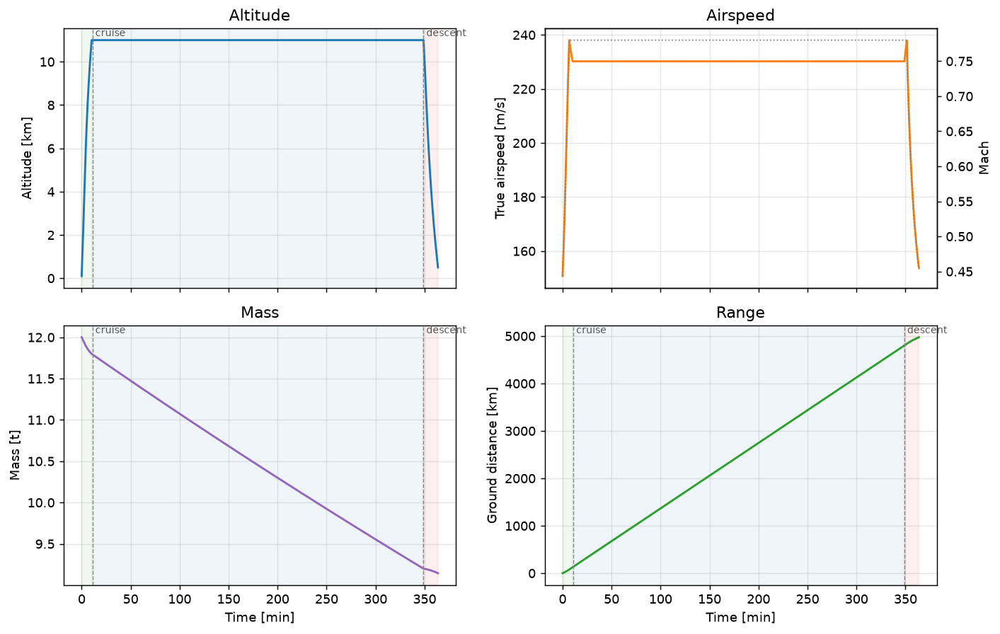

# Flight-Traj-Sim

**Point-mass aircraft trajectory simulation — climb, cruise and descent — with zero
runtime dependencies.**



Given a handful of numbers you would actually find on a type certificate — mass, wing
area, a drag polar, a thrust rating and a fuel burn — Flight-Traj-Sim integrates the
equations of motion for a complete mission and tells you how far the aircraft goes, how
long it takes and how much fuel it burns. It runs as a Python package, a command line
tool, a self-contained web page and a native Windows application. All four use the same
model and produce identical numbers.

---

## What problem does this solve?

Aircraft performance work usually splits into two uncomfortable extremes:

* **Back-of-envelope formulas.** Breguet's range equation is elegant and fast, but it
  assumes a perfect cruise and says nothing about the climb, the descent, whether the
  aircraft can reach its cruise altitude at all, or what happens when the drag polar
  and the thrust lapse fight each other.
* **Full six-degree-of-freedom simulations.** Accurate, but they need a stability
  derivative database, a trim routine and a control law before they answer a single
  question about range.

Flight-Traj-Sim sits in between. It is the classical **point-mass performance model**:
the aircraft is a particle, the flight path is coordinated, and the controls are the
speed schedule and the throttle. That is enough to answer the questions that actually
come up early in a design — *can it reach FL350?*, *what does 10 % more drag cost me?*,
*is this engine big enough?* — in a few milliseconds, with equations you can read.

It is deliberately built for **exploration**: every parameter is a slider, every run is
instant, and infeasible designs are reported rather than crashing.

---

## Quick start

```bash
pip install -e .            # or: pip install .
flighttrajsim run
```

```
Mission summary
---------------
Range            :   4975.0 km
  of which cruise:   4666.1 km
Endurance        :    363.7 min
Fuel burned      :   2855.0 kg
Final altitude   :    500.0 m
Final TAS        :    153.7 m/s
Final mass       :   9145.0 kg
Cruise throttle  :    0.654 (start of cruise)
Peak CL          :    0.499
Completed        : True
```

Sweep a parameter:

```bash
flighttrajsim sweep --param cd0 --values 0.020 0.025 0.030 0.035
flighttrajsim breguet                 # analytic cross-check of the cruise segment
```

### Python API

```python
from flighttrajsim import AircraftTrajSim, AircraftParams, MissionProfile

sim = AircraftTrajSim(
    aircraft=AircraftParams(m0=13000.0, fuel_mass=3500.0, cd0=0.028),
    mission=MissionProfile(h_cruise=12000.0, cruise_mach=0.80),
)
result = sim.run_simulation()

print(result.range_km, result.endurance_min, result.fuel_burned_kg)
print(result.summary())

for row in sim.sweep("m0", [10000.0, 12000.0, 14000.0]):
    print(row["m0"], row["range_km"])
```

`result` exposes the histories as plain lists — `result.t`, `result.h`, `result.v`,
`result.x`, `result.m` — plus `result.phases`, `result.range_km`, `result.endurance_s`
and `result.fuel_burned_kg`.

### Web application

Open **`web/index.html`** in any browser. No build step, no server, no network request:
the entire solver is about 200 lines of JavaScript embedded in the page, ported
function-for-function from the Python package. Twelve sliders re-run the mission as you
drag them, and a sensitivity tab sweeps any parameter over its useful range.

### Desktop application

```bash
pip install -r requirements-gui.txt     # PySide6-Essentials
python -m desktop
```

Pre-built Windows executable: download `FlightTrajSim.exe` from the
[releases page](https://github.com/newbiesilas/Flight-Traj-Sim/releases) and run it —
no Python required. To build it yourself:

```bash
pip install pyinstaller
pyinstaller flighttrajsim-gui.spec
# -> dist/FlightTrajSim.exe
```

---

## The model

Everything is SI: kilograms, metres, seconds, newtons, kelvin.

### Atmosphere

International Standard Atmosphere (ICAO Doc 7488 / US Standard Atmosphere 1976),
troposphere and lower stratosphere:

| layer | temperature | pressure |
|---|---|---|
| 0 – 11 km | `T = 288.15 − 0.0065 H` | `p = p₀ (T/T₀)^5.2559` |
| 11 – 20 km | `T = 216.65` | `p = p₁₁ exp(−(H−H₁₁)/6341.6)` |

`H` is **geopotential** altitude, `H = r h /(r + h)` with `r = 6 356 766 m`. The ISA
tables are tabulated in `H`, and using geometric altitude instead shifts the density by
about 0.3 % at the tropopause and 1 % at 20 km — small, but enough to fail a test
against the standard tables.

### Aerodynamics

Parabolic polar with a compressibility increment:

```
CL = m g cos γ / (q S)          q = ½ ρ V²
CD = CD0 + k CL² + 12 max(0, M − M_crit)³
D  = q S CD
```

The cubic wave-drag term is a standard engineering fit: nothing below the critical Mach
number, then a steep but finite rise.

### Engine

```
T = T_SL · σ^n · δ          σ = ρ/ρ₀,  δ = throttle
ṁ_fuel = TSFC · T
```

`n = 0.9` sits between the classical turbofan value (0.7) and the pure-turbojet limit
(1.0), which puts the cruise thrust fraction in the realistic 0.6 – 0.8 band.

### Climb and descent — speed schedule, angle from excess power

This is the part that is easy to get wrong. A model that *prescribes* the flight-path
angle (`γ = 5°` all the way to 11 km) is unphysical: a few degrees of climb is simply
not available in thin air, and the aircraft responds by decelerating into a stall.

Instead the speed is prescribed and the angle follows from the **specific excess
power** — which is how a real aircraft is actually flown:

```
V(h)   = min( CAS / √σ ,  M_cr · a(h) )        constant CAS, then constant Mach
sin γ  = (T − D) / W                            all excess thrust becomes altitude
dh/dt  = V sin γ
dx/dt  = V cos γ
dm/dt  = −TSFC · T_delivered
```

with two details that matter:

* `γ` is clamped to the airframe limit (8° by default). Near the ground the excess
  thrust exceeds what the schedule allows.
* the **delivered** thrust is `min(T_available, D + W sin γ)`, not the commanded
  thrust. When the angle is limited the engines are no longer at full throttle, and
  metering fuel at the commanded value overstates the burn badly.

### Cruise — constant Mach, trimmed throttle

```
V   = M_cr · a(h_cruise)        (constant)
T   = D                          autothrottle trims to equilibrium
dx/dt = V
dm/dt = −TSFC · D
```

This is Breguet's equation integrated numerically rather than in closed form, which is
why the simulated cruise segment reproduces

```
R = V (L/D) / (TSFC · g) · ln(m₀/m₁)
```

to **0.15 %** on the default aircraft. Flying constant Mach with an autothrottle is
also what makes the model robust: a constant-throttle cruise is only stable on the
front side of the thrust-required curve, and a heavy aircraft at a low Mach number is
behind it.

### Numerics

Classical fixed-step RK4 (`dt = 2 s`) with terminal events located by linear
interpolation of the last step. No NumPy, no SciPy — `rk4_step` and `integrate_phase`
are about 60 lines of plain Python, and the JavaScript port is a line-for-line
translation.

### Guards

An infeasible design must fail loudly and cheaply, not silently:

* **fuel exhaustion** — a phase stops when the tanks reach dry mass;
* **climb stall** — a climb that gains no altitude for 600 s is declared stalled at its
  ceiling;
* **thrust shortfall** — a cruise that needs more throttle than exists is reported with
  the number it needed.

Partial trajectories are always returned and `completed` is set to `False`, so sweeps
over a wide design space never blow up.

---

## Default aircraft

A ~12 t twin-turbofan in the regional-jet / midsize-business-jet class. Engineering
plausible, not any specific type.

| group | parameter | default |
|---|---|---|
| Aircraft | take-off mass `m0` | 12 000 kg |
| | usable fuel | 3 000 kg |
| | reserve fuel | 200 kg |
| | wing area `S` | 24 m² |
| Aero | `CD0` | 0.025 |
| | induced factor `k` | 0.048 → `(L/D)max = 14.4` |
| | `CL_max`, `M_crit` | 1.4, 0.82 |
| Engine | sea-level thrust | 39 000 N (`T/W = 0.33`) |
| | TSFC | 1.6 × 10⁻⁵ kg/(N s) ≈ 0.57 lb/(lbf h) |
| | lapse exponent `n` | 0.9 |
| Mission | start / cruise / end altitude | 100 m / 11 000 m / 500 m |
| | climb CAS | 150 m/s |
| | cruise Mach | 0.78 |
| | descent throttle | 0.15 |

Baseline result: **4 975 km**, **364 min**, **2 855 kg** of fuel, cruise throttle 0.65.

---

## Validation

The test suite (`pytest`, 90 tests) does not just check that numbers move; it checks
them against physics:

| check | result |
|---|---|
| ISA density / pressure / temperature vs the standard tables (0–20 km) | pass |
| simulated cruise segment vs closed-form Breguet | 0.15 % |
| `sin γ = (T − D)/W` when the climb angle is not limited | exact |
| `(L/D)max` at `CL = √(CD0/k)` reproduced by the polar | exact |
| range peaks at the wing area giving `CL = √(CD0/k)` | 14 m² found, 16.9 m² predicted |
| monotonicity: heavier / draggier / thirstier ⇒ shorter range | pass |
| an under-powered aircraft is *reported*, not crashed | pass |
| a stalled climb never burns more fuel than it carries | pass |
| RK4 integrates `e^t` to ~1e-6 | pass |

The JavaScript model is validated by running the exact source embedded in
`web/index.html` inside Node (`node tests/test_web_model.js`, 34 checks) — including a
comparison against the Python numbers, which agree to machine precision.

---

## Layout

```
flighttrajsim/
    atmosphere.py    ISA, geopotential conversion, speed schedule
    aero.py          parabolic polar, wave drag, Breguet range
    engine.py        thrust lapse, fuel flow, level-flight equilibrium speeds
    params.py        dataclasses for aircraft / engine / mission, with validation
    integrate.py     fixed-step RK4 with terminal events and abort guards
    core.py          the mission solver
    plot.py          optional matplotlib figures (lazy import)
    utils.py         CSV export, formatted summaries
    cli.py           command line interface
desktop/
    chart.py         QPainter chart widget (no matplotlib)
    app.py           Qt desktop application
web/index.html       self-contained browser application
examples/            runnable demonstrations
tests/               pytest suite + the Node check for the JS model
```

## Testing

```bash
python -m pytest            # 90 tests
node tests/test_web_model.js  # 34 checks on the browser model
```

## Limitations

* Point mass only: no rotation, no sideslip, no structural or engine limits beyond
  `CL_max` and the thrust ceiling.
* No wind, no temperature deviation from ISA, no compressibility correction on the
  calibrated airspeed.
* Single cruise segment — no step climbs.
* Turbofan model only: no propeller or turbojet efficiency maps.

## License

MIT — see [LICENSE](LICENSE).
